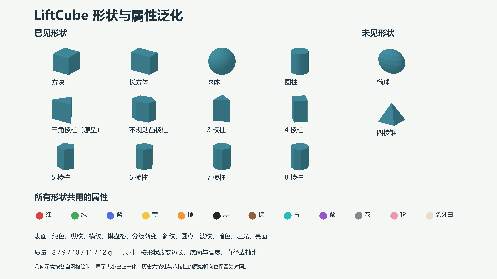

# LiftCube 单物体泛化环境 / Single-object generalization

| 环境 / Environment | 场景与接触面 / Scene and contacts | 视觉控制脚本 / RGB | 特权 state 控制脚本 / Privileged state |
| --- | --- | --- | --- |
| 课程原始环境 / Course | 课程镜像中的红方块、桌面和机械臂，沿用原碰撞面与求解参数 | 红方块轮廓与已标定抓姿 | 读取方块位置与偏航 |
| 团队修复泛化版 / Team extension | 在课程 USD 上叠加机械臂刚体连杆、物体与桌面的碰撞修正层 | 前视图分割、轮廓跟踪、夹面对中，细长盒沿短边闭合 | 复用同一特权控制器，读取当前物体位置与偏航 |

两套环境沿用课程机械臂、60 Hz 物理步进、30 Hz 关节指令和原生抬升判定。视觉模式读取 RGB、关节反馈及重置后的相机标定。特权模式单列成绩。课程基线的设置与历史成绩见[控制脚本指南](SCRIPTED_LIFTCUBE.md)。

The course profile runs the original red cube with the original solver settings. Selecting an object scene enables the team's collision overlays and generalization profile. Both use the course joint interface, timing and native lift score. RGB uses the calibrated front camera and joint feedback. The privileged controller additionally reads object position and yaw.

## 环境与评测的改动范围 / Scope of the extension

| 项目 / Item | 课程红方块 / Course | 修复泛化版 / Team |
| --- | --- | --- |
| 碰撞 / Contacts | 使用课程 USD 和原求解参数 | 用机械臂刚体连杆（含两指）的可见网格建立碰撞面，物体按形状建立接触面，桌面使用可见三角面。PhysX 位置与速度求解的最低迭代数分别为 255 和 4 |
| 重置 / Reset | 沿用课程初态与扰动 | 根据物体高度相对 30 mm 方块的差值，将初始中心高度调整半个高度差。水平摆放和朝向沿用课程随机化 |
| 相机 / Camera | 沿用课程重置流程 | 配对评测在每次重置前恢复前视相机名义位姿，渲染并刷新传感器，然后执行带 seed 的课程重置。相机型号与观测接口共用 |
| 任务和计分 / Task and scoring | 红方块抬升，专用脚本配置使用种子 1000–1049 | 任务文字改为通用物体抬升，配对配置使用 42000、42001。沿用同一抬升判据、关节动作映射、夹爪驱动和回合上限 |

The extension raises contact solver iterations within the same 60 Hz physics step. Its object layer supplies the reset height offset. For paired evaluations the runner seeds environment creation and restores the nominal front camera before each seeded reset. The action interface, joint drives, reward and native lift criterion are shared with the course benchmark.

## 物体目录 / Catalogue



[打开 8K 原图 / Open the 7680 × 4320 PNG](../assets/liftcube-shapes-and-attributes-8k.png)。图中各物体按自身网格绘制，显示大小已归一化。实际尺寸见下表。

196 种几何尺寸 × 12 种颜色 × 11 种外观 × 5 档质量，共 129,360 个场景。按零起始编号生成，范围为 0–129359。

| 分组 / Split | 形状 / Shape | 尺寸 / Dimensions |
| --- | --- | --- |
| 已见 / Seen | 方块、球体 / cube, sphere | 30 mm 基准的 85%、90%、100%、110%、115% |
| 已见 / Seen | 长方体、圆柱 / box, cylinder | 长方体长 32/36/40、宽 18/22/28、高 27/30/33 mm；圆柱直径 20/24/28、高 24/30/36 mm，另含等比对照 |
| 已见 / Seen | 棱柱 / prisms | 三至八棱，外接圆直径 20/24/28、高 24/30/36 mm，另含历史截面与朝向 |
| 未见 / Held-out family | 椭球、四棱锥 / ellipsoid, square pyramid | 椭球三轴独立变化，含 45 × 20 × 30 mm；四棱锥底宽和高度独立变化 |

每种几何均有红、绿、蓝、黄、橙、黑、棕、青、紫、灰、粉、象牙白；纯色、纵纹、横纹、斜纹、格纹、渐变、圆点、波纹、暗色、哑光和亮面；质量为 8–12 g，间隔 1 g。已见形状占 100,320 项，未见形状占 29,040 项。“未见”指本目录按形状家族划定的评测组，早期开发记录包含部分椭球、棱锥。

Each geometry is crossed with every colour, appearance and mass. Colour and texture affect rendering, while mass changes the rigid body. The held-out label refers to the family split in this catalogue. Some of these shapes also occur in earlier development runs.

## 生成与运行 / Generate and run

在[课程配套环境](../course/liftcube/README.md)内，从仓库根目录进入以下目录。将 `COURSE_SCENE` 设置为课程镜像中原始 `table_with_cube/scene.usd` 的路径，保留其相邻资源。生成器使用 OpenUSD、NumPy 和 Pillow，视觉控制器还使用 SciPy。每个输出目录使用新名称。

Run in the matching course simulator environment. Point `COURSE_SCENE` at the original scene in that installation with its adjacent assets intact. The generator writes separate scene layers and textures alongside the requested output. Keep these relative paths together.

```bash
cd course/liftcube
export PYTHONPATH="$PWD/src${PYTHONPATH:+:$PYTHONPATH}"
python -m starter.scripts.object_catalog --source "$COURSE_SCENE" \
  --id 0 --output runs/objects/000000.usda
python -m starter.scripts.evaluate_scripted --run-simulation \
  --object-scene runs/objects/000000.usda --config configs/scripted/generalization.yaml \
  --calibration configs/scripted/front_rgb.json --runtime-camera-calibration --output runs/general-rgb-0
python -m starter.scripts.evaluate_scripted --run-simulation \
  --object-scene runs/objects/000000.usda --config configs/scripted/generalization.yaml \
  --calibration configs/scripted/privileged_state.json --privileged-state --output runs/general-state-0
```

泛化配置使用相同的 42000、42001 两个摆放 seed。课程红方块使用 `configs/scripted/eval.yaml`，省略 `--object-scene`。两套配置都在 480、960 个物理步统计 8 秒、16 秒成功；首次抓取成功要求原生评分成功且此前重抓次数为零。运行清单记录场景来源和选用的控制器。

For the course benchmark use the original evaluation YAML and omit the object scene argument. The two generalization runs use the same placement seeds. Score success by 8 and 16 seconds from the native completion step, and first-attempt success from the retry count in the per-step log.

## 接触修复与验收 / Contact geometry

修复在独立 USD 层中完成，按封闭碰撞体体积和指定质量更新物体密度。红方块 seed 1001 的成对诊断中，保留同一视觉控制脚本，仅修正接触面后，指面最大测得穿入从 11.956 mm 降至 0.276 mm。承载时仍可能出现瞬时重叠，验收时分别记录夹爪与物体、物体与桌面的穿入深度。

On the red cube, seed 1001, the maximum measured finger penetration fell from 11.956 mm to 0.276 mm with the contact fix. This is a single paired diagnostic. Discrete contacts can still show transient overlap under load. Compare assets by checking their visual and collision surfaces, then measure finger–object and object–table penetration during the grasp.
